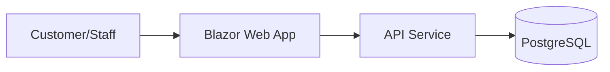

# BrewPoint Cafe Architecture

## Overview
BrewPoint Cafe is a unified platform comprising a customer-facing responsive website and a staff management dashboard. The system utilizes .NET 8, Blazor Server, and PostgreSQL.



## Modules
- **Domain**: Core business logic (Product, Order, Customer, Inventory).
- **Application**: Use cases (Checkout, Inventory Management, Sales Analytics).
- **Infrastructure**: Data persistence (EF Core) and external service integrations.
- **Api**: RESTful endpoints for the dashboard and mobile operations.
- **Web**: Blazor interactive server-side UI.

## Folder Structure
```
/src
  /BrewPoint.Domain
  /BrewPoint.Application
  /BrewPoint.Infrastructure
  /BrewPoint.Api
  /BrewPoint.Web
/tests
  /BrewPoint.UnitTests
  /BrewPoint.IntegrationTests
/db
  schema.sql
  procedures.sql
  seed.sql
```

## Entities
- **Product**: id, name, category, price, stock_quantity, image_url.
- **Order**: id, total_amount, payment_method, status, customer_id, created_at.
- **OrderItem**: id, order_id, product_id, quantity, unit_price.
- **Customer**: id, name, email, loyalty_points.
- **Location**: id, name, address, opening_hours.

## API Endpoints
- `GET /api/v1/products`
- `POST /api/v1/orders`
- `GET /api/v1/analytics/daily-sales`
- `GET /api/v1/customers`

## Decisions
- **Clean Architecture**: Decouple domain logic from infrastructure.
- **PostgreSQL**: Robust, relational storage for transactional data.
- **Blazor Server**: Simplifies state management for the POS dashboard.
