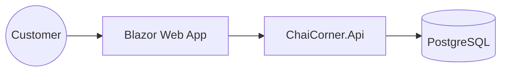

# Architecture: Chai Corner Café

Namespace Prefix: `ChaiCorner`

## Context
Chai Corner Café is a neighbourhood café in Koramangala, Bangalore. The system supports customers viewing the menu, checking offers, and contacting the café.

## Container Diagram

## Modules
- **Domain**: Core entities (Menu, Order, Offer).
- **Application**: Use cases for menu management and customer inquiries.
- **Infrastructure**: Persistence via EF Core and PostgreSQL.
- **Api**: REST endpoints for the web client.
- **Web**: Blazor UI for menu display and information.

## Entities
- `MenuItem`: id, name, price, category, description.
- `Offer`: id, title, description, discount_percent, valid_until.
- `ContactInquiry`: id, name, email, message, created_at.

## Use Cases
- `GetMenuQuery`: Retrieve all menu items.
- `GetOffersQuery`: Retrieve active promotions.
- `CreateInquiryCommand`: Submit contact form.

## API Endpoints
| Method | Endpoint | Description |
|---|---|---|
| GET | /api/v1/menu | List all items |
| GET | /api/v1/offers | List active offers |
| POST | /api/v1/inquiries | Submit contact form |

## Non-Functional Requirements
- **Security**: HTTPS, input validation, rate limiting.
- **Performance**: Response time < 200ms for menu queries.
- **Scalability**: Supports 30 concurrent users.

## Decisions Log
- **Decision**: Use Clean Architecture to ensure separation of concerns.
- **Reason**: Facilitates testing and future maintenance.

## Security (STRIDE)
- **Spoofing**: Use OIDC for admin access.
- **Tampering**: Validate all inputs via FluentValidation.
- **Repudiation**: Audit logs for all inquiries.
- **Information Disclosure**: No sensitive data in logs.
- **Denial of Service**: Rate limiting on API.
- **Elevation of Privilege**: Role-based access control.

## Permissions Matrix
| Role | View Menu | Submit Inquiry | Manage Menu |
|---|---|---|---|
| Customer | Yes | Yes | No |
| Admin | Yes | Yes | Yes |
