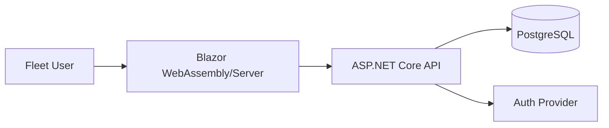

# Fleet Tracker Architecture

## Overview
Fleet Tracker is a .NET 8 Blazor-based internal dashboard for managing a fleet of 40 delivery vans. It supports three roles: Fleet Manager, Dispatcher, and Viewer.

## Container Diagram

## Modules
- **Domain**: Core business rules (Van, Driver, Maintenance).
- **Application**: CQRS Handlers, validation, and interfaces.
- **Infrastructure**: EF Core, Repositories, PostgreSQL.
- **API**: Controllers, ProblemDetails, OpenAPI.
- **Web**: Blazor components, charts, and dashboard views.

## Folder Structure
- `src/FleetTracker.Domain`
- `src/FleetTracker.Application`
- `src/FleetTracker.Infrastructure`
- `src/FleetTracker.Api`
- `src/FleetTracker.Web`

## Data Entities
- **Van**: `id uuid`, `plate text`, `status text`, `last_maintenance_date timestamptz`.
- **Driver**: `id uuid`, `name text`, `license_expiry timestamptz`.
- **Maintenance**: `id uuid`, `van_id uuid`, `cost numeric(18,2)`, `description text`.

## API Endpoints
- `GET /api/v1/vans`
- `GET /api/v1/kpis`
- `POST /api/v1/maintenance`
- `GET /api/v1/reports/fuel`

## Key Design Decisions
- **Architecture**: Clean Architecture (Onion) to ensure separation of concerns.
- **Database**: PostgreSQL with strict naming conventions and UTC-only timestamps.
- **Security**: OAuth 2.0 + Role-based Access Control (RBAC).
- **Time**: `TimeProvider` used for testability across the stack.
