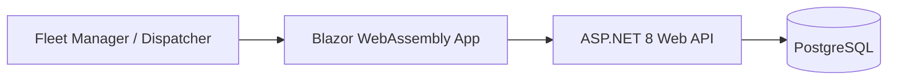

# Fleet Tracker Architecture

## Overview
Fleet Tracker is an internal SaaS dashboard for managing a fleet of 40 delivery vans, tracking driver compliance, and monitoring maintenance logs. The system enables fleet managers and dispatchers to maintain operational efficiency.

## Container Diagram


## Modules
- **Fleet Management**: Van tracking, status management.
- **Maintenance**: Logging and scheduling repairs.
- **HR/Compliance**: Driver records, license expiry tracking.
- **Reporting**: Aggregating fuel costs and delivery metrics.

## Folder Structure
```
src/
  FleetTracker.Domain/          # Entities, Enums, Domain Rules
  FleetTracker.Application/     # CQRS Handlers, DTOs, Interfaces, Validation
  FleetTracker.Infrastructure/  # EF Core, PostgreSQL Repositories
  FleetTracker.Api/             # Controllers, Middleware, Auth
  FleetTracker.Web/             # Blazor Components, Pages, State Management
```

## Data Entities
- **Van**: id, plate_number, model, status, last_maintenance_date.
- **Driver**: id, name, license_number, license_expiry_date.
- **MaintenanceLog**: id, van_id, description, cost, date.
- **Delivery**: id, van_id, driver_id, status, completion_time, fuel_cost.

## API Endpoints
| Method | Endpoint | Description |
|---|---|---|
| GET | /api/v1/vans | List vans with status filter |
| POST | /api/v1/maintenance | Add log |
| DELETE | /api/v1/maintenance/{id} | Delete log |
| GET | /api/v1/reports/fuel | Monthly fuel aggregate |

## Key Design Decisions
- **CQRS-lite**: Decoupling read/write operations for scalability.
- **PostgreSQL**: Chosen for relational integrity and support for complex reporting queries.
- **Role-based Access**: Custom claims-based policies (`FleetManager`, `Dispatcher`, `Viewer`).
