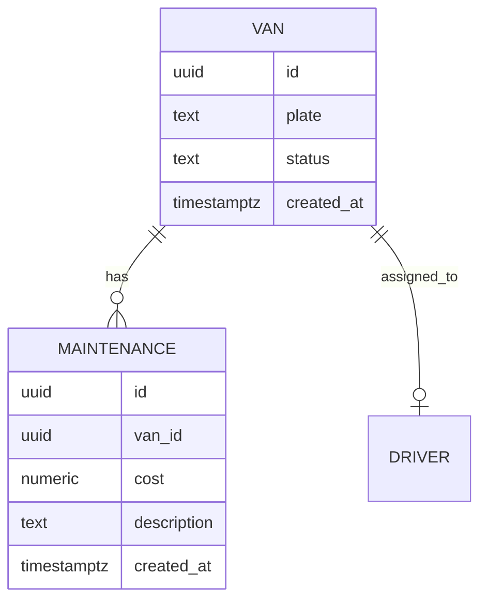

# 05 Database

## PostgreSQL conventions
- Tables: `vans`, `drivers`, `maintenance`.
- Columns: `id uuid primary key`, `created_at timestamptz`, `updated_at timestamptz`.
- Currency: `numeric(18,2)`.

## ER Diagram

