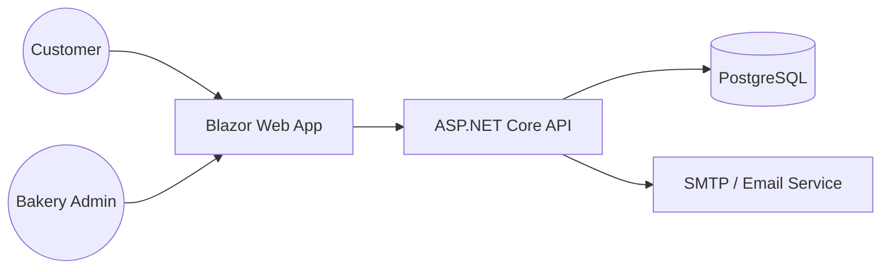

# Architecture Document: Golden Crust Bakery

## Overview
Golden Crust Bakery is a premium artisan bakery platform serving Dubai customers. It provides a public-facing catalogue, a pre-order system for daily pickups, and an administrative dashboard for order management.

## Context Diagram


## Folder Structure
```
src/
  GoldenCrust.Domain          # Entities: Order, Product, Category
  GoldenCrust.Application     # Use Cases, DTOs, FluentValidation
  GoldenCrust.Infrastructure  # EF Core, DbSeeder, SMTP service
  GoldenCrust.Api             # REST Controllers, ProblemDetails
  GoldenCrust.Web             # Blazor Components (Pages/Layouts)
tests/
  GoldenCrust.UnitTests       # Domain logic & Application handlers
  GoldenCrust.IntegrationTests# API endpoint testing with Testcontainers
```

## Data Entities
- **Product**: `id`, `name_en`, `name_ar`, `price`, `category`, `image_url`
- **Order**: `id`, `customer_name`, `phone`, `product_id`, `quantity`, `pickup_date`, `status` (Pending, Ready, Completed)

## API Endpoints
| Method | Endpoint | Description |
|---|---|---|
| GET | /api/v1/products | List available products |
| POST | /api/v1/orders | Create a new pre-order |
| GET | /api/v1/orders | List orders (Admin only) |
| PATCH | /api/v1/orders/{id} | Update order status |

## Design Decisions
- **CQRS-lite**: Decoupled commands (create order) from queries (get product list) to keep handlers focused.
- **Localization**: Uses .NET `IStringLocalizer` for English and Arabic support, managed in resources.
- **Reliability**: Uses database transactions for order creation to ensure stock consistency if extended.
