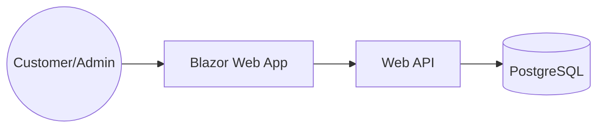

# 03 Architecture - Golden Crust Bakery

## Overview
Golden Crust Bakery is an artisan bakery ordering platform for customers in Dubai. It facilitates product browsing, daily specials, reviews, and pre-orders. Admins manage the catalog and order lifecycle.

## Container Diagram


## Modules
- **Domain**: Core entities (Product, Order, Review).
- **Application**: CQRS Handlers, validation, business logic.
- **Infrastructure**: Entity Framework Core, Repository pattern, Postgres.
- **Api**: REST endpoints (v1).
- **Web**: Blazor interactive server-side UI.

## Folder Structure
```
src/
  GoldenCrust.Domain/
  GoldenCrust.Application/
  GoldenCrust.Infrastructure/
  GoldenCrust.Api/
  GoldenCrust.Web/
tests/
  GoldenCrust.UnitTests/
  GoldenCrust.IntegrationTests/
```

## Data Entities
- **Product**: id, name, description, price (decimal), currency, image_url, is_special (bool).
- **Order**: id, customer_name, phone, product_id, quantity, pickup_date, status (new, baking, ready, collected, cancelled).
- **Review**: id, customer_name, rating, comment.

## API Endpoints
- `GET /api/v1/products`
- `POST /api/v1/orders`
- `GET /api/v1/admin/orders`
- `PUT /api/v1/admin/orders/{id}/status`

## Design Decisions
- **Clean Architecture**: Decouples business logic from frameworks.
- **CQRS**: Separates commands and queries for scalability.
- **Money**: Used decimal(18,2) for AED storage.
- **Performance**: Interactive Server mode for low-latency updates in Dubai.
