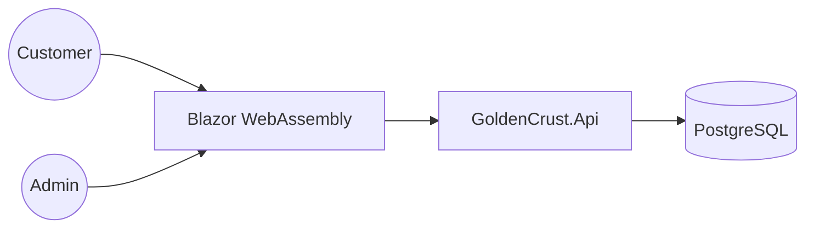

# 03 Architecture - Golden Crust Bakery

## Overview
Golden Crust Bakery is a dual-language (English/Arabic) web application for an artisan bakery in Dubai. It enables customers to view products, read about the bakery, and submit pre-order requests. Admins can view and manage these orders.

### Mermaid Container Diagram


## Modules
- **Domain**: Core business models (Order, Product).
- **Application**: Order processing logic, validation.
- **Infrastructure**: Entity Framework Core, PostgreSQL repository implementations.
- **Api**: REST endpoints for pre-orders and product catalog.
- **Web**: Blazor UI with localization support.

## Folder Structure
```
src/
  GoldenCrust.Domain/
  GoldenCrust.Application/
  GoldenCrust.Infrastructure/
  GoldenCrust.Api/
  GoldenCrust.Web/
tests/
  GoldenCrust.UnitTests/
  GoldenCrust.IntegrationTests/
```

## Data Entities
- **Product**: id, name_en, name_ar, description, price, currency (AED), is_daily_special, is_bestseller.
- **PreOrder**: id, customer_name, phone, product_id, quantity, pickup_date, status, created_at.

## API Endpoints
- `GET /api/v1/products`: List products.
- `POST /api/v1/orders`: Submit pre-order.
- `GET /api/v1/orders`: List orders (Admin only).

## Design Decisions
- **Localization**: Use `IStringLocalizer` for English/Arabic support.
- **Currency**: `decimal` (numeric(18,2)) for prices, stored as AED.
- **Architecture**: Clean Architecture enforced to ensure domain integrity and testability.
