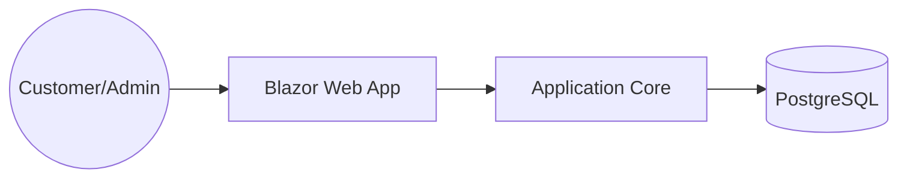

# Architecture: Golden Crust Bakery

## Overview
Golden Crust Bakery is a premium artisan bakery platform built with .NET 8, Blazor (Server), and PostgreSQL. It supports English and Arabic, enabling customers to pre-order products and allowing admins to manage orders.

## Container Diagram


## Modules
- **Domain**: Entities (Product, Order, Testimonial), Value Objects.
- **Application**: CQRS Handlers, FluentValidation, DTOs.
- **Infrastructure**: Entity Framework Core, Repository pattern.
- **Web**: Blazor components, Localization, UI Layout.

## Folder Structure
```
src/
  GoldenCrust.Domain/
  GoldenCrust.Application/
  GoldenCrust.Infrastructure/
  GoldenCrust.Api/
  GoldenCrust.Web/
```

## Data Entities
- **Product**: id, name_en, name_ar, description_en, description_ar, price_aed, category, is_available.
- **Order**: id, customer_name, phone, product_id, quantity, pickup_date, status (pending, ready, completed).

## API Endpoints
- `GET /api/v1/products`
- `POST /api/v1/orders`
- `GET /api/v1/orders` (Admin only)
- `PATCH /api/v1/orders/{id}/status` (Admin only)

## Design Decisions
- **Localization**: Use `IStringLocalizer` for English/Arabic support.
- **Architecture**: Onion Architecture to keep domain logic independent.
- **UI**: Premium, spacious design using Plus Jakarta Sans and Inter fonts.
