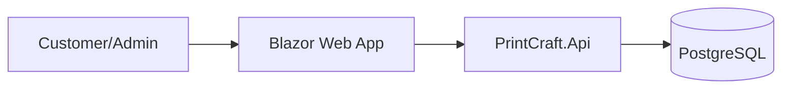

# 03 Architecture

## Overview
PrintCraft is an online custom printing store based in Bangalore, India. It provides a platform for customers to order custom prints across categories like business cards, flyers, and apparel.

## Container Diagram


## Modules
- **Domain**: Core business logic (Orders, Products, Design Files).
- **Application**: Use cases (PlaceOrder, CalculatePrice, UpdateOrderStatus).
- **Infrastructure**: Database access (EF Core), File storage (Blob Storage).
- **Api**: RESTful endpoints.
- **Web**: Blazor Interactive Server UI.

## Folder Structure
```
src/
  PrintCraft.Domain/
  PrintCraft.Application/
  PrintCraft.Infrastructure/
  PrintCraft.Api/
  PrintCraft.Web/
tests/
  PrintCraft.UnitTests/
  PrintCraft.IntegrationTests/
```

## Data Entities
- **Product**: Id, Name, BasePrice, Category, Options (JSON), Active.
- **Order**: Id, CustomerId, Items (List), TotalAmount, Status, GstAmount, ShippingAddress.
- **OrderItem**: Id, ProductId, Quantity, UnitPrice, FileUrl.

## API Endpoints
- `GET /api/v1/products`
- `POST /api/v1/orders`
- `GET /api/v1/orders/{id}`
- `PUT /api/v1/orders/{id}/status`

## Design Decisions
- **CQRS**: Simplified implementation for maintainability.
- **Currency**: All amounts stored in smallest unit (paise) or as decimal to avoid floating point issues.
- **UI**: Tailwind CSS with custom purple/yellow theme for a modern aesthetic.
