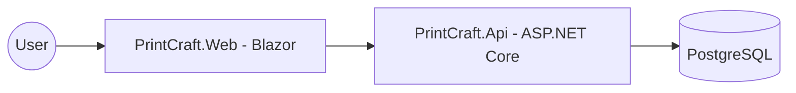

# PrintCraft Architecture

## Overview
PrintCraft is an e-commerce platform for custom printing services. It uses a Clean Architecture approach with .NET 8, Blazor Server, and PostgreSQL.

## Container Diagram


## Modules
- **Domain**: Core entities and business rules (Order, Product, Category, OrderItem).
- **Application**: CQRS handlers, DTOs, and validation logic.
- **Infrastructure**: EF Core, Repositories, and Database configuration.
- **Api**: REST endpoints for the frontend.
- **Web**: Blazor Interactive Server UI.

## Folder Structure
```
src/
  PrintCraft.Domain/
  PrintCraft.Application/
  PrintCraft.Infrastructure/
  PrintCraft.Api/
  PrintCraft.Web/
tests/
  PrintCraft.UnitTests/
  PrintCraft.IntegrationTests/
```

## Data Entities
- **Product**: id, name, category, base_price, description, stock, image_url.
- **Order**: id, customer_details, total_amount, status, created_at.
- **OrderItem**: id, order_id, product_id, quantity, unit_price, customization_json.

## API Endpoints
- `GET /api/v1/products`: List products with filtering.
- `GET /api/v1/products/{id}`: Get product details.
- `POST /api/v1/orders`: Place an order.
- `GET /api/v1/orders/{id}`: Track order status.

## Design Decisions
- **Clean Architecture**: Decouple business logic from infrastructure.
- **Database**: PostgreSQL with direct SQL scripts for schema management (no EF migrations).
- **Security**: OAuth2 for Auth; RLS for data isolation.
