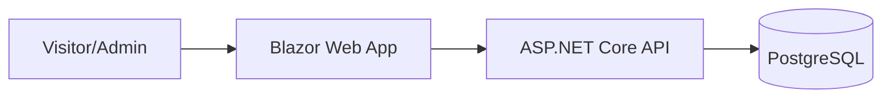

# 03 Architecture - Pulse Fitness Studio

## Overview
Pulse Fitness Studio is a boutique fitness platform for a location in Dubai Marina. The system enables visitors to view class schedules, learn about fitness programs, and book free trial classes, while administrators manage classes, trainers, and memberships.

## Container Diagram


## Modules
- **Domain**: Core entities (Class, Trainer, Booking, Membership).
- **Application**: Use cases for booking, scheduling, and admin management.
- **Infrastructure**: Persistence (EF Core), external email notifications.
- **Api**: REST endpoints.
- **Web**: Blazor Interactive Server UI.

## Folder Structure
```
src/
  PulseFitness.Domain/
  PulseFitness.Application/
  PulseFitness.Infrastructure/
  PulseFitness.Api/
  PulseFitness.Web/
tests/
  PulseFitness.UnitTests/
  PulseFitness.IntegrationTests/
```

## Data Entities
- **ClassType**: Name, Intensity (Enum), DurationMinutes.
- **Trainer**: Name, Specialty, PhotoUrl.
- **ClassSchedule**: ClassTypeId, TrainerId, StartTime, EndTime.
- **Booking**: Name, Phone, Email, ClassId, PreferredDate, Status.
- **Membership**: Name, PriceAed, Description.

## API Endpoints
- `GET /api/v1/classes`
- `GET /api/v1/schedule`
- `POST /api/v1/bookings`
- `GET /api/v1/trainers`

## Key Design Decisions
- **Clean Architecture**: Decoupled layers for maintainability.
- **Blazor Interactive Server**: Provides a dynamic, high-performance user experience without the complexity of a SPA framework.
- **PostgreSQL**: Robust, ACID-compliant relational storage.
