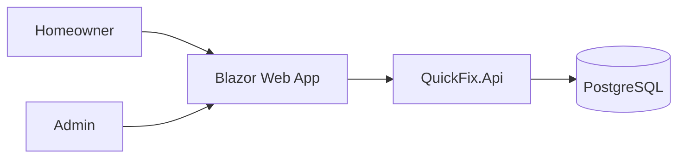

# Architecture: QuickFix Home Services

.NET Namespace Prefix: `QuickFix`

## Context
QuickFix Home Services is a platform connecting homeowners in Hyderabad with professional tradespeople (plumbers, electricians, AC technicians). The system facilitates service booking, technician assignment, job tracking, and payment processing.

## Container Diagram

## Modules
- **Domain**: Core business logic (Booking, Technician, ServiceType, Payment).
- **Application**: Use cases (CreateBooking, AssignTechnician, UpdateJobStatus).
- **Infrastructure**: Persistence (EF Core), Email/Notification services.
- **Api**: REST endpoints for the Web UI.
- **Web**: Blazor Server UI for customers and admins.

## Entities
- **Booking**: `id`, `customer_id`, `service_type`, `address`, `scheduled_at`, `status`, `technician_id`, `total_price`.
- **Technician**: `id`, `name`, `specialty`, `phone`, `is_available`.
- **Payment**: `id`, `booking_id`, `amount`, `status`, `payment_method`.

## Use Cases
- `CreateBookingCommand`: Customer requests a service.
- `AssignTechnicianCommand`: Admin assigns a technician to a booking.
- `UpdateJobStatusCommand`: Technician updates job progress.
- `GetBookingsQuery`: List bookings for admin/customer.

## API Endpoints
| Method | Endpoint | Description |
|---|---|---|
| POST | /api/v1/bookings | Create a new booking |
| GET | /api/v1/bookings | List bookings |
| PATCH | /api/v1/bookings/{id}/assign | Assign technician |
| PATCH | /api/v1/bookings/{id}/status | Update job status |

## Non-Functional Requirements
- **Security**: OAuth2/OIDC authentication, RLS in PostgreSQL.
- **Performance**: Response time < 200ms for API calls.
- **Scalability**: Horizontal scaling via stateless API.
- **Backups**: Daily automated RDS/PostgreSQL snapshots.

## Decisions Log
- **Decision**: Use Clean Architecture to ensure domain logic is decoupled from infrastructure.
- **Reason**: Facilitates easier testing and future-proofing against framework changes.

## Security (STRIDE)
- **Spoofing**: Mitigated by OIDC/JWT.
- **Tampering**: Mitigated by HTTPS and database constraints.
- **Repudiation**: Mitigated by audit logs on all status changes.
- **Information Disclosure**: Mitigated by RLS and field-level access control.
- **Denial of Service**: Mitigated by rate limiting.
- **Elevation of Privilege**: Mitigated by role-based access control (RBAC).

## Permissions Matrix
| Role | Create Booking | Assign Tech | Update Status | View Reports |
|---|---|---|---|---|
| Homeowner | Yes | No | No | No |
| Technician | No | No | Yes | No |
| Admin | No | Yes | Yes | Yes |
