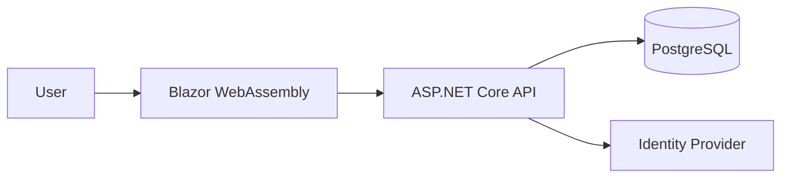

# 03 Architecture

## Overview
Restriviz is a restaurant POS system designed for small cafes. It follows Clean Architecture principles, ensuring clear separation between domain logic, application use cases, and infrastructure concerns.

## Container Diagram

## Module List
- **Domain**: Core entities (Product, Order, OrderItem, Table, Category).
- **Application**: CQRS handlers for menu management, POS order processing, and payment execution.
- **Infrastructure**: Entity Framework Core repository implementation, PostgreSQL configuration.
- **Api**: RESTful endpoints and request validation.
- **Web**: Blazor interactive server-side UI, state management, and API integration.

## Data Entities
- **Product**: id, category_id, name, price, is_veg, is_available.
- **Category**: id, name.
- **Order**: id, table_id, type (dine-in/takeaway), status, total_amount, payment_status, created_at.
- **OrderItem**: id, order_id, product_id, quantity, notes, price_at_order.
- **Table**: id, name, is_occupied.

## API Endpoints
- `GET /api/v1/menu`
- `POST /api/v1/menu`
- `GET /api/v1/orders`
- `POST /api/v1/orders` (Checkout)
- `GET /api/v1/dashboard`

## Design Decisions
- **CQRS**: Used to keep handlers focused.
- **Server-side Calculation**: All financial calculations are performed on the server to prevent client-side manipulation.
- **Database**: PostgreSQL with snake_case naming and no migrations (direct schema management).
