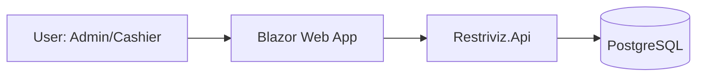

# Restriviz Architecture

## Overview
Restriviz is a restaurant POS system tailored for a small cafe in Bengaluru. It handles menu management, order processing, and payment recording.

## Container Diagram


## Modules
- **Domain**: Core business logic (Orders, Products, Payments).
- **Application**: CQRS handlers, validation, DTOs.
- **Infrastructure**: Entity Framework Core implementation.
- **Api**: REST controllers, authentication.
- **Web**: Blazor UI components.

## Folder Structure
```
src/
  Restriviz.Domain/
  Restriviz.Application/
  Restriviz.Infrastructure/
  Restriviz.Api/
  Restriviz.Web/
tests/
  Restriviz.UnitTests/
  Restriviz.IntegrationTests/
```

## Data Entities
- **Category**: `id`, `name`.
- **Product**: `id`, `category_id`, `name`, `price`, `is_veg`, `is_available`.
- **Table**: `id`, `number`.
- **Order**: `id`, `table_id`, `type` (Dine-in/Takeaway), `total_amount`, `discount`, `status`.
- **OrderItem**: `id`, `order_id`, `product_id`, `quantity`, `price`.
- **Payment**: `id`, `order_id`, `type` (Cash/Card/UPI), `amount`.

## API Endpoints
- `GET /api/v1/menu`
- `POST /api/v1/menu/products`
- `POST /api/v1/orders`
- `POST /api/v1/orders/{id}/payments`

## Design Decisions
- **Clean Architecture**: Decoupled layers for maintainability.
- **Server-side Calculation**: All financial logic resides in the Application layer to prevent tampering.
- **Currency**: Fixed to INR using `numeric(18,2)`.
- **Auth**: JWT-based authentication with Admin/Cashier roles.
