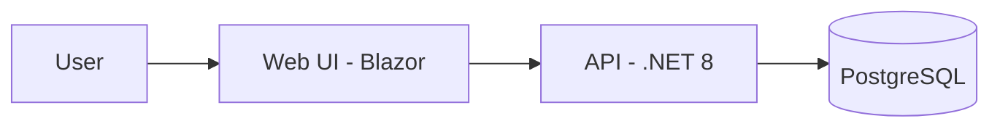

# Smart Retail POS & Inventory Management Architecture

## Overview
Smart Retail is a POS and Inventory Management system designed for retail environments, featuring automated stock tracking, billing, and sales analytics.

## Container Diagram

## Modules
- **Domain**: Core business logic and entities.
- **Application**: Use cases, CQRS handlers, and validation.
- **Infrastructure**: Database access via EF Core, persistence.
- **Api**: RESTful endpoints.
- **Web**: Blazor Interactive Server UI.

## Data Entities
- **Product**: ID, Name, SKU, Price, StockQuantity, CategoryID.
- **Order**: ID, OrderNumber, TotalAmount, Tax, Discount, PaymentMethod, CreatedAt.
- **OrderItem**: ID, OrderID, ProductID, Quantity, PriceAtPurchase.

## API Endpoints
- `GET /api/v1/products`: List products.
- `POST /api/v1/orders`: Create new order.
- `GET /api/v1/dashboard/stats`: Retrieve revenue/sales metrics.

## Key Design Decisions
- **Clean Architecture**: Decoupled layers to ensure domain logic remains framework-agnostic.
- **Database**: PostgreSQL with manual SQL scripts for schema control to avoid EF migrations drift.
- **Security**: JWT-based authentication with role-based policies.
